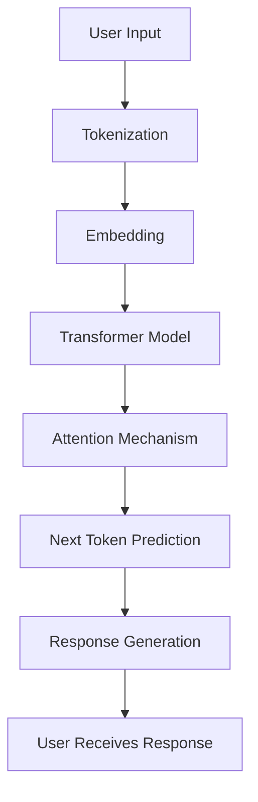

# How Large Language Models (LLMs) Work

## 1. What is an LLM?

A Large Language Model (LLM) is an artificial intelligence model trained on a large amount of text data. It understands patterns in language and generates human-like responses based on the input provided by a user.

Examples of LLMs include GPT, Gemini, and Llama.

## 2. How Does an LLM Work?

An LLM generally works through the following steps:

1. **User Input:** The user enters a question or instruction.
2. **Tokenization:** The input text is divided into smaller units called tokens.
3. **Embedding:** Tokens are converted into numerical representations that the model can process.
4. **Transformer Processing:** The model uses transformer architecture and attention mechanisms to understand relationships between tokens.
5. **Next-Token Prediction:** The model predicts the next token based on the previous context.
6. **Response Generation:** The process continues until the model generates a complete response.

## 3. LLM Working Diagram

## 4. Important Concepts

### Tokens
Tokens are smaller pieces of text that an LLM processes. A token can represent a word, part of a word, or punctuation.

### Embeddings
Embeddings convert tokens into numerical vectors so that the model can process language mathematically.

### Transformer
A transformer is a neural network architecture used by modern LLMs to process sequences of tokens and understand their relationships.

### Attention Mechanism
Attention helps the model identify which parts of the input are important when generating a response.

### Next-Token Prediction
An LLM generates text by predicting one token at a time based on the context it has received.

## 5. How LLMs Can Help in KrishiYojana

In the KrishiYojana project, an LLM can help farmers ask questions in natural language.

For example:

- Which government schemes are available for farmers?
- What documents are required for agricultural subsidies?
- Which schemes provide assistance for irrigation?

The LLM can help understand the farmer's question and generate a readable response using relevant scheme information.

However, an LLM should not invent government scheme benefits or eligibility conditions. Responses should be grounded in verified scheme records.

## 6. Limitations of LLMs

- LLMs can sometimes generate incorrect information.
- They may not know the latest government scheme updates.
- They can produce answers that sound correct but are not supported by the available data.
- Their responses depend on the quality of their training data and provided context.

## 7. Conclusion

Large Language Models make it possible for computers to understand and generate human-like text. They use tokenization, embeddings, transformer architecture, attention, and next-token prediction to generate responses.

In KrishiYojana, LLM technology can make agricultural scheme information easier for farmers to access through natural-language questions.